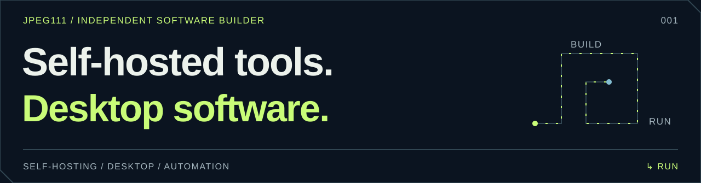
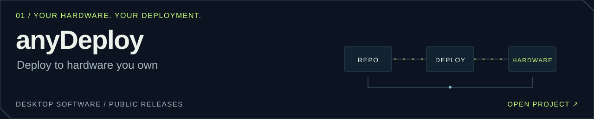
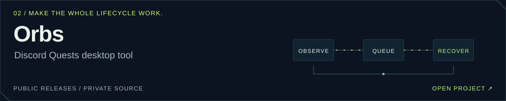
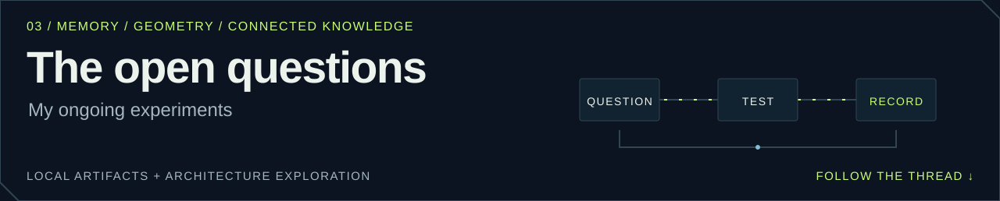
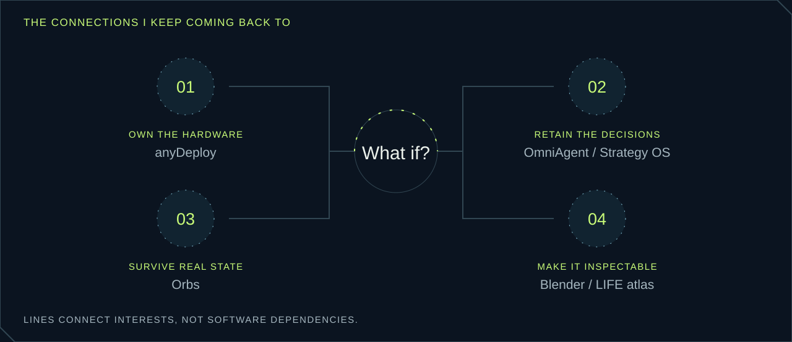

<picture>
  <source media="(max-width: 600px) and (prefers-color-scheme: light)" srcset="assets/profile/intro-mobile-light.svg">
  <source media="(max-width: 600px)" srcset="assets/profile/intro-mobile-dark.svg">
  <source media="(prefers-color-scheme: light)" srcset="assets/profile/intro-light.svg">
  
</picture>

  <a href="#selected-systems"><kbd>01 / Projects</kbd></a> &nbsp;
  <a href="#follow-a-question"><kbd>02 / Thinking</kbd></a> &nbsp;
  <a href="#build-trail"><kbd>03 / Evidence</kbd></a> &nbsp;
  <a href="#next-coordinates"><kbd>04 / Roadmap</kbd></a>

**Skandar · Netherlands**

I build self-hosted tools, desktop apps and AI workflows. I like the point where software meets something real: a spare phone, a running desktop client, an editable 3D scene.

I build with AI, and I keep asking follow-up questions. What does this depend on? What happens when it fails? What would prove it works? The answer usually becomes another piece of the system.

## Selected systems

<a href="https://github.com/JPEG111/anydeploy-releases">
<picture>
  <source media="(max-width: 600px) and (prefers-color-scheme: light)" srcset="assets/profile/anydeploy-mobile-light.svg">
  <source media="(max-width: 600px)" srcset="assets/profile/anydeploy-mobile-dark.svg">
  <source media="(prefers-color-scheme: light)" srcset="assets/profile/anydeploy-light.svg">
  
</picture>
</a>

**An old phone can have another job.** anyDeploy brings deployment to Android, Raspberry Pi, Linux and Windows targets. Public Windows and Linux releases; the next Studio and agent workflows are in development.

[Project](https://github.com/JPEG111/anydeploy-releases) · [Downloads](https://github.com/JPEG111/anydeploy-releases/releases/latest)

<a href="https://github.com/JPEG111/orbs-release">
<picture>
  <source media="(max-width: 600px) and (prefers-color-scheme: light)" srcset="assets/profile/orbs-mobile-light.svg">
  <source media="(max-width: 600px)" srcset="assets/profile/orbs-mobile-dark.svg">
  <source media="(prefers-color-scheme: light)" srcset="assets/profile/orbs-light.svg">
  
</picture>
</a>

**The interesting part is everything around the button.** Orbs is Windows tooling around Discord Quests: a visual queue, English / Egyptian Arabic UI, recovery, packaging and updates.

The **1.21.14 checkpoint** verified a **657-test suite against source and compiled builds**, with native/browser fixtures and selected live-client checks. [Release notes](https://github.com/JPEG111/orbs-release/releases/tag/v1.21.14) · [Verification context](docs/ACHIEVEMENTS.md#orbs--making-the-whole-lifecycle-work)

<a href="#lab-notes">
<picture>
  <source media="(max-width: 600px) and (prefers-color-scheme: light)" srcset="assets/profile/lab-mobile-light.svg">
  <source media="(max-width: 600px)" srcset="assets/profile/lab-mobile-dark.svg">
  <source media="(prefers-color-scheme: light)" srcset="assets/profile/lab-light.svg">
  
</picture>
</a>

<b>Inside the lab / local artifacts, prototypes and open questions</b>

| Thread | What I've worked on | Current stage |
| :--- | :--- | :--- |
| **OmniAgent** | Local tools, controlled operations and companion workflows | Local builds; customer acceptance still open |
| **Strategy OS** | Plans that connect decisions, evidence, memory and workflow gates | Architecture exploration |
| **Local image-to-3D** | Multiview experiments and reference-specific Blender reconstructions | Editable scenes and GLBs; dimensions inferred |
| **Life OS** | Android quests and deterministic progression | Prototype |
| **LIFE atlas** | Linked Markdown, Obsidian Canvas/Bases and an offline 3D browser map | Dated project inventory |

These are different stages of work. Public downloads are linked on the two projects above.

<picture>
  <source media="(max-width: 600px) and (prefers-color-scheme: light)" srcset="assets/profile/atlas-mobile-light.svg">
  <source media="(max-width: 600px)" srcset="assets/profile/atlas-mobile-dark.svg">
  <source media="(prefers-color-scheme: light)" srcset="assets/profile/atlas-light.svg">
  
</picture>

## Follow a question

I don't usually stop at the first explanation. **Open the question and follow it deeper:**

<b>Why did the agent forget?</b>

Did it fail to save the decision, fail to retrieve it, or retrieve it and ignore it? Those need different fixes.

<b>What should the system around the agent remember?</b>

The decision, its source, the alternatives, what failed, and the current state of the work.

<b>What has to be true before it can take the next step?</b>

That's the design problem I keep coming back to: make prerequisites and evidence part of the workflow. My Lego-machine analogy is that a missing piece should become visible before the next piece goes in.

<b>And what happens when that memory gets too big?</b>

Now the questions are retrieval quality, context growth, stale decisions and the cost of recording too much. That needs a bounded experiment with measurable failures.

**A better question is another way into the build.**

This habit also runs through my long research conversations, including discussions around **Andoria**: following questions across subjects, comparing explanations, and staying willing to change the answer when the evidence changes.

## Build trail

- [x] **Hardware → hosting:** took phone-hosting ideas into anyDeploy's public Windows and Linux release artifacts.
- [x] **Feature → lifecycle:** built bilingual Orbs workflows, recovery and data-preserving installer/update checks.
- [x] **Image → editable artifact:** changed methods when generated geometry missed the reference; produced Blender scenes and GLB exports.
- [x] **Folders → connected knowledge:** built a project atlas with native Obsidian views and a separate offline 3D view.
- [ ] **Memory → dependable execution:** prove a bounded workflow that retrieves decisions and checks prerequisites across a long task.

[Read the achievement notes →](docs/ACHIEVEMENTS.md)

## Next coordinates

| NOW | NEXT | EXPLORE |
| :--- | :--- | :--- |
| Close observed onboarding and client-state gaps in the main products. | Test persistent decisions and workflow gates on one bounded task. | Compare creative outputs against references and make the builds repeatable. |
| **Progress:** fresh evidence from a supported real workflow. | **Progress:** fewer missed decisions, stale facts and repeated mistakes. | **Progress:** preserved candidates, explained choices, reproducible exports. |

Direction reviewed **1 November 2026**, without promised delivery dates. [Full roadmap →](docs/ROADMAP.md)

<b>Workbench / tools picked for the problem</b>

`TypeScript` `React` `Electron` `Python` `Node.js` `PowerShell` `Linux` `SSH` `Blender` `Markdown` `Obsidian`

Interfaces, automation, local tools, hardware experiments and creative pipelines. The connections between them are where I spend most of my time.

<b>One more loop / the contribution arcade</b>

<picture>
  <source media="(prefers-color-scheme: dark)" srcset="https://raw.githubusercontent.com/JPEG111/JPEG111/output/pacman-contribution-graph-dark.svg">
  
</picture>

Still following the question. <a href="#top">↳ Back to the beginning</a> · <a href="docs/DESIGN.md">Built for the README</a>

