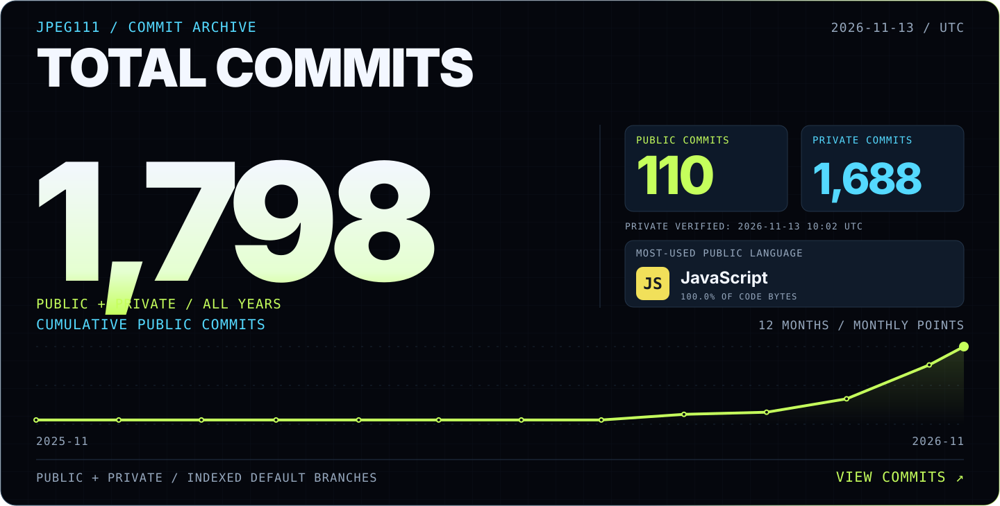
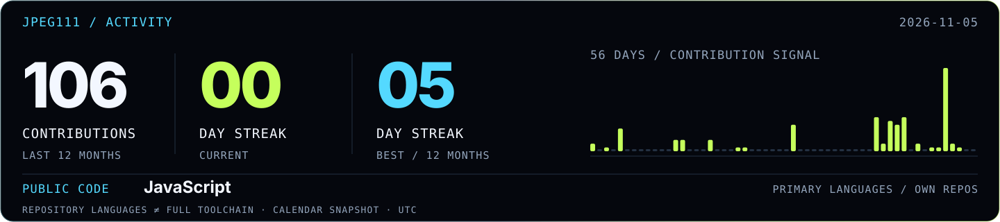

<a href="https://github.com/search?q=author%3AJPEG111+is%3Apublic&amp;type=commits">
<picture>
  <source media="(max-width: 600px)" srcset="https://raw.githubusercontent.com/JPEG111/JPEG111/profile-activity/commit-counter-mobile.svg?v=2">
  
</picture>
</a>

<a href="https://github.com/JPEG111?tab=overview">
<picture>
  <source media="(max-width: 600px)" srcset="https://raw.githubusercontent.com/JPEG111/JPEG111/profile-activity/activity-mobile.svg">
  
</picture>
</a>

<picture>
  <source media="(max-width: 600px)" srcset="assets/profile/system-hero-mobile.svg">
  
</picture>

  <a href="#user-content-selected-systems"><kbd>Released software</kbd></a> &nbsp;
  <a href="#user-content-the-lab"><kbd>Inside the lab</kbd></a> &nbsp;
  <a href="#user-content-tech-stack"><kbd>Languages & tools</kbd></a> &nbsp;
  <a href="#user-content-next-coordinates"><kbd>Roadmap</kbd></a> &nbsp;
  <a href="#user-content-github-activity"><kbd>Arcade</kbd></a>

### Skandar · Software developer

Netherlands · Desktop software / infrastructure / AI

I turn **spare hardware into servers**, **saved media into searchable libraries**, and **AI models into tools you can use**.

I care about **what happens after the demo**: a connection drops, models compete for GPU memory, a document reflows, or a desktop interface changes. That’s where a lot of my work happens.

## Released software

<a href="https://github.com/JPEG111/anydeploy-releases">
<picture>
  <source media="(max-width: 600px)" srcset="assets/profile/system-anydeploy-mobile.svg">
  
</picture>
</a>

### Deploy on hardware you own.

From a repository to a running app on **Android / Termux, Raspberry Pi, Linux or Windows / WSL2**. Framework detection, builds, `nginx`, `PM2`, TLS and Cloudflare routing share one workflow.

**When Wi-Fi drops, the deployment can reconnect and resume.** Services and routes stay inspectable after the first successful build.

> **Studio / development build**
> Live websites stay interactive on 3D device screens. **Fixed page layout, variable render density.** Visual occlusion and click boundaries agree, including where the device hides part of a screen.

[Project →](https://github.com/JPEG111/anydeploy-releases) · [Windows / Linux downloads](https://github.com/JPEG111/anydeploy-releases/releases/latest) · [Under the hood](docs/ENGINEERING.md#anydeploy)

<a href="https://github.com/JPEG111/orbs-release">
<picture>
  <source media="(max-width: 600px)" srcset="assets/profile/system-orbs-mobile.svg">
  
</picture>
</a>

### Automation that checks the state.

A Windows app for supported Discord Quests, with **discovery, queues, tray controls and updates** in English and Egyptian Arabic.

**Observe → act → verify.** Semantic control discovery, bounded retries and retained deadlines keep the workflow tied to what the client actually shows. An uncertain action needs a check before it is repeated.

[Project →](https://github.com/JPEG111/orbs-release) · [Windows download](https://github.com/JPEG111/orbs-release/releases/latest) · [State and recovery](docs/ENGINEERING.md#orbs)

<a href="https://github.com/JPEG111/InstaVault-Releases">
<picture>
  <source media="(max-width: 600px)" srcset="assets/profile/system-instavault-mobile.svg">
  
</picture>
</a>

### Find the thing you saved.

Import posts and shared media, enrich them with **local AI tagging, OCR and embeddings**, then explore through **graph, fuzzy and semantic search**.

`Electron` + `React` + `FastAPI`. Optional transcription uses **its own Python process**, keeping its ML dependencies separate from the frozen backend.

[Project →](https://github.com/JPEG111/InstaVault-Releases) · [Windows download](https://github.com/JPEG111/InstaVault-Releases/releases/latest) · [Pipeline and packaging](docs/ENGINEERING.md#instavault)

## Inside the lab

Working local builds and experiments. Each explores a different constraint.

<picture>
  <source media="(max-width: 600px)" srcset="assets/profile/system-jarvis-mobile.svg">
  
</picture>

### JARVIS · Voice, vision and a shared GPU

Wake word → VAD → `Whisper` → `LangGraph` → streamed `Chatterbox` speech.

**Start speaking while the answer is still arriving.** Sentence queues separate generation from playback; model fallbacks and saved project state carry the workflow. Heavier vision work can unload speech models to recover GPU memory.

[Voice pipeline and memory tradeoffs →](docs/ENGINEERING.md#jarvis)

<picture>
  <source media="(max-width: 600px)" srcset="assets/profile/system-lumina-mobile.svg">
  
</picture>

### Lumina · Edit the document directly

Unstructured text becomes **one typed document shared across twelve templates**. AI edits and pointer controls operate on the same data.

**A drag can change the page.** Layout overrides, text wrapping, pagination and native browser print have to work together.

[Layout, reflow and print →](docs/ENGINEERING.md#lumina)

<picture>
  <source media="(max-width: 600px)" srcset="assets/profile/system-luminal-mobile.svg">
  
</picture>

### Luminal · Give the camera a direction

Named angles and an orbit control feed image-model requests. Choose **a single call or a six-stage pipeline** that separates subject, environment, pose, composite and face refinement.

**Reuse the expensive preparation.** Session caches retain source and subject analysis until the input changes.

[Spatial controls and generation pipelines →](docs/ENGINEERING.md#luminal)

<b>Also building: OmniAgent — a local action layer for AI tools</b>

**Workspace boundaries. Hash-checked edits. Durable task state.** Receipts make local AI actions inspectable, with explicit access and recovery behavior.

Local build; clean-machine acceptance and public distribution remain separate work.

[Architecture notes →](docs/ENGINEERING.md#omniagent)

<picture>
  <source media="(max-width: 600px)" srcset="assets/profile/system-stack-mobile.svg">
  
</picture>

## Languages & tools

Across the desktop apps, services and creative tools.

**Languages**

**Frameworks, APIs & infrastructure**

**Tools & creative**

<picture>
  <source media="(max-width: 600px)" srcset="assets/profile/system-roadmap-mobile.svg">
  
</picture>

## Where the work is heading

| Area | Next engineering goal |
| :--- | :--- |
| **Deployment** | Exercise setup, recovery and upgrades across more real hardware. |
| **Desktop automation** | Expand client-layout coverage while keeping actions bounded and saved state intact. |
| **AI tooling** | Make model handoffs, remembered decisions and tool results easier to inspect. |
| **Visual editors** | Keep data, direct manipulation and exported output in agreement. |

[Build notes](docs/ENGINEERING.md) · [Roadmap details](docs/ROADMAP.md)

<picture>
  <source media="(max-width: 600px)" srcset="assets/profile/system-arcade-mobile.svg">
  
</picture>

## The contribution arcade

<picture>
  <source media="(prefers-color-scheme: dark)" srcset="https://raw.githubusercontent.com/JPEG111/JPEG111/output/pacman-contribution-graph-dark.svg">
  <source media="(prefers-color-scheme: light)" srcset="https://raw.githubusercontent.com/JPEG111/JPEG111/output/pacman-contribution-graph.svg">
  
</picture>

<a href="#user-content-top">↑ Back to top</a>

