<a href="https://github.com/search?q=author%3AJPEG111+is%3Apublic&amp;type=commits">
<picture>
  <source media="(max-width: 600px)" srcset="https://raw.githubusercontent.com/JPEG111/JPEG111/profile-activity/commit-counter-mobile.svg?v=4">
  
</picture>
</a>

<a href="https://github.com/JPEG111?tab=overview">
<picture>
  <source media="(max-width: 600px)" srcset="https://raw.githubusercontent.com/JPEG111/JPEG111/profile-activity/activity-mobile.svg?v=3">
  
</picture>
</a>

<picture>
  <source media="(max-width: 600px)" srcset="https://raw.githubusercontent.com/JPEG111/JPEG111/profile-activity/system-hero-mobile.svg?v=5">
  
</picture>

  <a href="#user-content-selected-systems"><kbd>Selected software</kbd></a> &nbsp;
  <a href="#user-content-the-lab"><kbd>Inside the lab</kbd></a> &nbsp;
  <a href="#user-content-behind-the-builds"><kbd>Behind the builds</kbd></a> &nbsp;
  <a href="#user-content-tech-stack"><kbd>Languages & tools</kbd></a> &nbsp;
  <a href="#user-content-next-coordinates"><kbd>Roadmap</kbd></a> &nbsp;
  <a href="#user-content-github-activity"><kbd>Arcade</kbd></a>

GitHub metrics and public releases refresh every 12 hours. Project animations demonstrate example state changes.

### Skandar · Software developer

Netherlands · Desktop software / infrastructure / AI

**I follow questions until they turn into working tools.** A repository becomes an app on a phone. A spoken request becomes a tool call and a streamed reply. A document becomes something I can rearrange and print.

I learn through the details that force a better question: why a webpage reflows when its 3D device rotates, why voice models compete for GPU memory, or how a saved decision becomes useful in a later task.

**Some work I’m proud of:**

- **A usable browser inside a 3D device.** Fixed website layout, variable render density, and click boundaries that follow what is actually visible. [Studio engineering →](docs/ENGINEERING.md#studio-a-browser-inside-a-device-inside-an-interface)
- **A voice loop built around a shared GPU.** Speech recognition, model/tool routing and sentence-by-sentence audio playback, with explicit model loading and unloading. [JARVIS →](docs/ENGINEERING.md#jarvis)
- **A research thread turned into a searchable workbench.** A preserved 98-source subtitle archive, a Python merger, and Arabic search, map and connection views. [How it grew →](docs/STORY.md#andoriaefnetwork-from-a-question-to-a-workbench)

Studio and JARVIS are development work. The archive count is a checked snapshot. Public downloads are linked below.

## Selected software

<a href="https://github.com/JPEG111/anydeploy-releases">
<picture>
  <source media="(max-width: 600px)" srcset="https://raw.githubusercontent.com/JPEG111/JPEG111/profile-activity/system-anydeploy-mobile.svg?v=5">
  
</picture>
</a>

### Deploy on hardware you own.

Choose **a GitHub repository or ZIP**, select an **Android / Termux, Raspberry Pi, Linux or Windows / WSL2** target, then build on that device. Static files are served by `nginx`; applications use a running process where needed. Reach the result through a **local address, temporary link or configured domain**.

**When Wi-Fi drops, the deployment can reconnect and resume.** Services and routes stay inspectable after the first successful build.

> **Studio / development build**
> Live websites stay interactive on 3D device screens. **Fixed page layout, variable render density.** Visual occlusion and click boundaries agree, including where the device hides part of a screen.

[Project →](https://github.com/JPEG111/anydeploy-releases) · [Windows / Linux downloads](https://github.com/JPEG111/anydeploy-releases/releases/latest) · [Under the hood](docs/ENGINEERING.md#anydeploy)

<a href="https://github.com/JPEG111/orbs-release">
<picture>
  <source media="(max-width: 600px)" srcset="https://raw.githubusercontent.com/JPEG111/JPEG111/profile-activity/system-orbs-mobile.svg?v=3">
  
</picture>
</a>

### Automation that checks the state.

A Windows app for supported Discord Quests, with **discovery, queues, tray controls and updates** in English and Egyptian Arabic.

**Observe → act → verify.** Semantic control discovery, bounded retries and retained deadlines keep the workflow tied to what the client actually shows. An uncertain action needs a check before it is repeated.

[Project →](https://github.com/JPEG111/orbs-release) · [Windows download](https://github.com/JPEG111/orbs-release/releases/latest) · [State and recovery](docs/ENGINEERING.md#orbs)

<a href="https://github.com/JPEG111/JPEG111/blob/main/docs/ENGINEERING.md#instavault">
<picture>
  <source media="(max-width: 600px)" srcset="https://raw.githubusercontent.com/JPEG111/JPEG111/profile-activity/system-instavault-mobile.svg?v=3">
  
</picture>
</a>

### Find the thing you saved.

Import posts and shared media, enrich them with **local AI tagging, OCR and embeddings**, then explore through **graph, fuzzy and semantic search**.

`Electron` + `React` + `FastAPI`. Optional transcription uses **its own Python process**, keeping its ML dependencies separate from the frozen backend.

Local build · Implementation case study

[Pipeline and packaging →](docs/ENGINEERING.md#instavault)

## Inside the lab

Working local builds and experiments. Each explores a different constraint.

<picture>
  <source media="(max-width: 600px)" srcset="https://raw.githubusercontent.com/JPEG111/JPEG111/profile-activity/system-jarvis-mobile.svg?v=5">
  
</picture>

### JARVIS · Voice, vision and a shared GPU

Wake word → VAD → `Whisper` → `LangGraph` → streamed `Chatterbox` speech.

**Start speaking while the answer is still arriving.** Sentence queues separate generation from playback; model fallbacks and saved project state carry the workflow. Heavier vision work can unload speech models to recover GPU memory.

[Voice pipeline and memory tradeoffs →](docs/ENGINEERING.md#jarvis)

<picture>
  <source media="(max-width: 600px)" srcset="https://raw.githubusercontent.com/JPEG111/JPEG111/profile-activity/system-lumina-mobile.svg?v=3">
  
</picture>

### Lumina · Edit the document directly

Unstructured text becomes **one typed document shared across twelve templates**. AI edits and pointer controls operate on the same data.

**A drag can change the page.** Layout overrides, text wrapping, pagination and native browser print have to work together.

[Layout, reflow and print →](docs/ENGINEERING.md#lumina)

<picture>
  <source media="(max-width: 600px)" srcset="https://raw.githubusercontent.com/JPEG111/JPEG111/profile-activity/system-luminal-mobile.svg?v=3">
  
</picture>

### Luminal · Give the camera a direction

Named angles and an orbit control feed image-model requests. Choose **a single call or a six-stage pipeline** that separates subject, environment, pose, composite and face refinement.

**Reuse the expensive preparation.** Session caches retain source and subject analysis until the input changes.

[Spatial controls and generation pipelines →](docs/ENGINEERING.md#luminal)

<b>Also building: OmniAgent — a local action layer for AI tools</b>

**Workspace boundaries. Hash-checked edits. Durable task state.** Receipts make local AI actions inspectable, with explicit access and recovery behavior.

Local build; clean-machine acceptance and public distribution remain separate work.

[Architecture notes →](docs/ENGINEERING.md#omniagent)

## The questions behind the builds

My interests reach into **physics, space, history and how institutions work**. The pattern is the same: follow the explanation, look for the mechanism, then find a way to inspect it.

<b>Cube → the system outside the room</b>

The *Cube* conversations started with who built the maze, who operated it, and who understood its purpose. I kept asking about the machinery outside the room. That is what the maze here represents: following a question, reaching a dead end and changing the route.

<b>Andoria / EFNETWORK → source material I could search and revisit</b>

I worked through subtitle collection, script errors, text cleanup and merging so I could inspect the source material across videos. The preserved archive contains **98 subtitle files**; the dashboard has **98 indexed transcripts**, with Arabic search, maps, a timeline and connections.

It became a data pipeline and an interface for comparing source material. [The longer story →](docs/STORY.md#andoriaefnetwork-from-a-question-to-a-workbench)

<b>AI memory → the next question underneath the answer</b>

Where does an assistant keep a decision after the conversation moves on?

Saving it creates another question.

What retrieves the right decision when a later task needs it? What keeps a workflow from skipping its prerequisites?

And when the memory keeps growing?

Does it become useful context, or a larger pile to search through? How do stale decisions get corrected? Those tradeoffs are part of what interests me about agent memory and durable task state.

[How I learned through the work](docs/STORY.md) · [Build milestones](docs/ACHIEVEMENTS.md)

<picture>
  <source media="(max-width: 600px)" srcset="https://raw.githubusercontent.com/JPEG111/JPEG111/profile-activity/system-stack-mobile.svg?v=3">
  
</picture>

## Languages & tools

Across the desktop apps, services and creative tools.

**Languages**

**Frameworks, APIs & infrastructure**

**Tools & creative**

<picture>
  <source media="(max-width: 600px)" srcset="https://raw.githubusercontent.com/JPEG111/JPEG111/profile-activity/system-roadmap-mobile.svg?v=3">
  
</picture>

## Where the work is heading

| Area | Next engineering goal |
| :--- | :--- |
| **Deployment** | Exercise setup, recovery and upgrades across more real hardware. |
| **Desktop automation** | Expand client-layout coverage while keeping actions bounded and saved state intact. |
| **AI tooling** | Make model handoffs, remembered decisions and tool results easier to inspect. |
| **Visual editors** | Keep data, direct manipulation and exported output in agreement. |

[Build notes](docs/ENGINEERING.md) · [Roadmap details](docs/ROADMAP.md)

<picture>
  <source media="(max-width: 600px)" srcset="https://raw.githubusercontent.com/JPEG111/JPEG111/profile-activity/system-arcade-mobile.svg?v=3">
  
</picture>

## The contribution arcade

<picture>
  <source media="(prefers-color-scheme: dark)" srcset="https://raw.githubusercontent.com/JPEG111/JPEG111/output/pacman-contribution-graph-dark.svg">
  <source media="(prefers-color-scheme: light)" srcset="https://raw.githubusercontent.com/JPEG111/JPEG111/output/pacman-contribution-graph.svg">
  
</picture>

<a href="#user-content-top">↑ Back to top</a>

